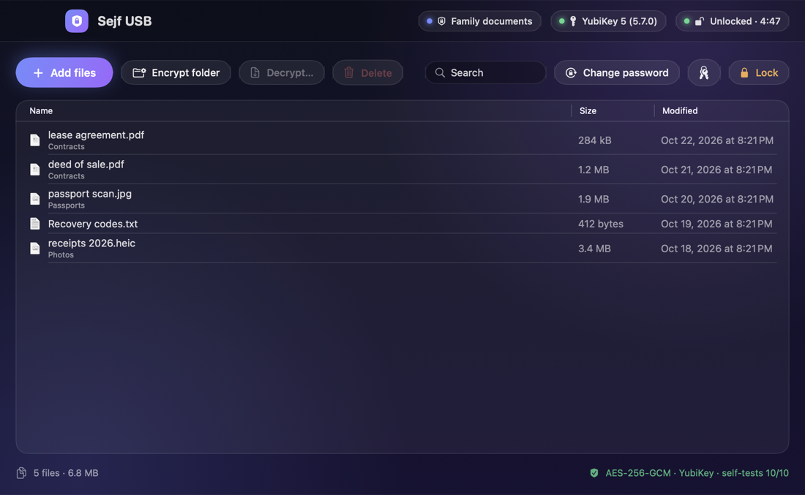
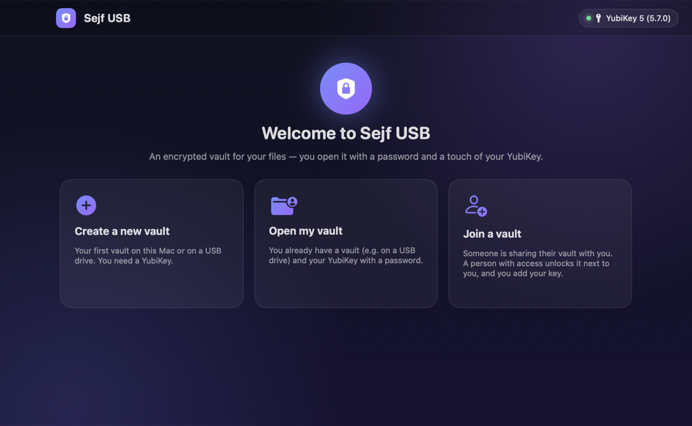
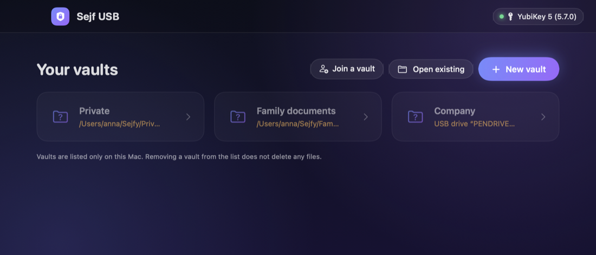
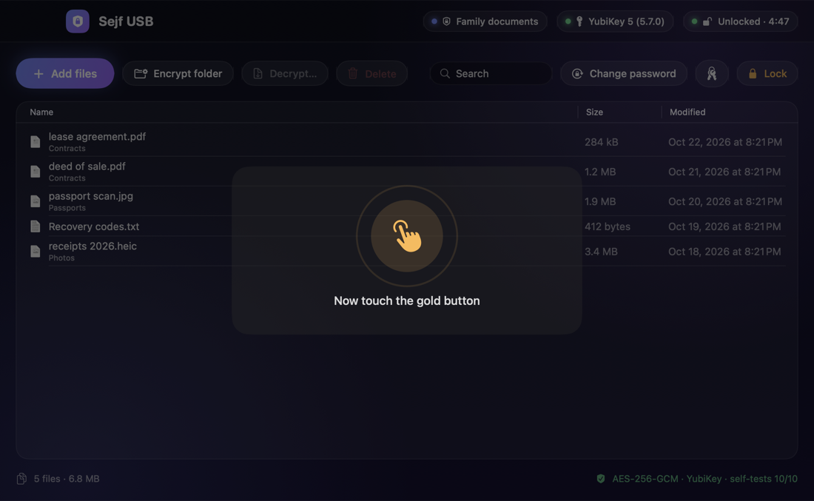

# Sejf USB

[](https://github.com/mhalaba/sejf-usb/actions/workflows/ci.yml)


[](LICENSE)

🇵🇱 [Wersja polska](README.md) · 🇬🇧 English

**An encrypted file vault for macOS, unlocked with a password and a touch of your YubiKey.** Fully offline, with no third-party dependencies and no special system permissions.

<p align="center"></p>

## Highlights

- 🔐 **AES-256-GCM.** A separate key for every file. File names are encrypted too, and tampering, truncation or reordering is detected.
- 🔑 **Password + YubiKey (FIDO2 `hmac-secret`).** The key's response is mixed into the encryption key; it is not a “gate” in the program. Without the physical key nobody can open the vault, even knowing the password.
- 💸 **Works with the cheaper Security Key NFC** and any FIDO2 key with `hmac-secret`. A FIDO2 PIN is supported where a key requires it.
- 👥 **Multiple users.** Everyone opens a shared vault with their own key and password. Joining happens locally, at one Mac.
- 🗂 **Multiple vaults:** on your Mac or on a USB drive.
- 🧯 **Recovery password** (160 bits) in case you lose your key.
- ♻️ **Master key replacement** invalidates old keys, passwords and header copies. It survives interruptions.
- 🧹 **Safe file migration.** An original is deleted only after a test decryption and SHA-256 comparison.
- 🧪 **NIST-approved algorithms and power-up self-tests** (FIPS 140-3 style). The project is not FIPS certified — see [Docs/en/06-FIPS.md](Docs/en/06-FIPS.md).
- 🛡 **Environment protection:** iCloud folders blocked, windows protected from screenshots, automatic locking (inactivity, sleep, drive removal).
- 🌐 **Polish and English**, following the system language or chosen in the menu.

| Welcome screen | Your vaults | Key touch |
|---|---|---|
|  |  |  |

## Installation

**Ready-made app:** download `SejfUSB-<version>.zip` from [Releases](https://github.com/mhalaba/sejf-usb/releases).
1. Verify the checksum:
   ```bash
   shasum -a 256 -c SejfUSB-<version>.zip.sha256
   ```
2. Copy `Sejf USB.app` into `~/Applications`.
3. The app is signed ad hoc, without Apple notarisation. On first launch you may need **System Settings → Privacy & Security → “Open Anyway”**.

**From source (recommended):** the Command Line Tools are enough.

```bash
git clone https://github.com/mhalaba/sejf-usb.git && cd sejf-usb
```
```bash
./build.sh test && ./build.sh
```

The app is installed in `~/Applications/Sejf USB.app`.

**Requirements:** macOS 14+ (Apple silicon or Intel) and a FIDO2 key with `hmac-secret`. Both the YubiKey 5 and the cheaper **Security Key NFC / C NFC** work; the full list is in the [user guide](Docs/en/01-User-guide.md#compatible-keys). On a Mac you plug the key into USB.

## Documentation

| | |
|---|---|
| [User guide](Docs/en/01-User-guide.md) | creating, unlocking, files, users, keys |
| [Installation](Docs/en/02-Installation.md) | other Macs, Gatekeeper, uninstalling |
| [Security](Docs/en/03-Security.md) | threat model, cryptography, audit, limitations |
| [Format specification](Docs/en/04-Format-specification.md) | exact `Sejf.vault` format |
| [Building and testing](Docs/en/05-Building-and-testing.md) | code structure, tests, translations |
| [FIPS 140](Docs/en/06-FIPS.md) | algorithms and NIST standards, self-tests, what certification would still need |
| [Changelog](Docs/en/CHANGELOG.md) | |

## How it works (in short)

```
KEK  = HKDF-SHA256( PBKDF2-SHA256(password, 3M iterations) ‖ FIDO2 hmac-secret(YubiKey) )
master key (256 bit)  ── AES-256-GCM under each KEK ──▶  keyslots in header.json
file ── HKDF(master key, file ID) ──▶ 1 MiB chunks, AES-256-GCM, number + “last” flag in the AAD
```

System frameworks only: CryptoKit, CommonCrypto, IOKit (FIDO2/CTAP2 over HID), CryptoTokenKit, SwiftUI.

## Honest limitations

No software can give 100% security:
- an **infected Mac** sees what you see while the vault is open;
- **overwriting files** on SSD or flash memory does not guarantee that old blocks are destroyed;
- **losing all keys and the recovery password** means permanent data loss.

Details: [Docs/en/03-Security.md](Docs/en/03-Security.md).

## Security and contributing

- Report vulnerabilities **privately**: [SECURITY.md](SECURITY.md) (Security → Report a vulnerability).
- Contributing: [CONTRIBUTING.md](CONTRIBUTING.md). Code comments and the source-language texts are in Polish; English translations live in `Sources/Core/Translations+EN.swift`.
- MIT license.
