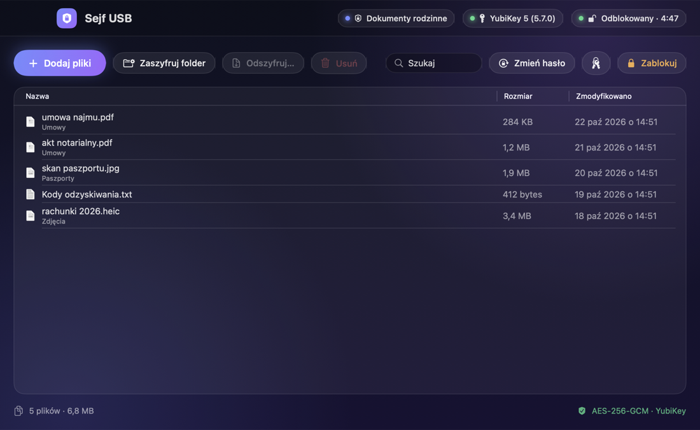
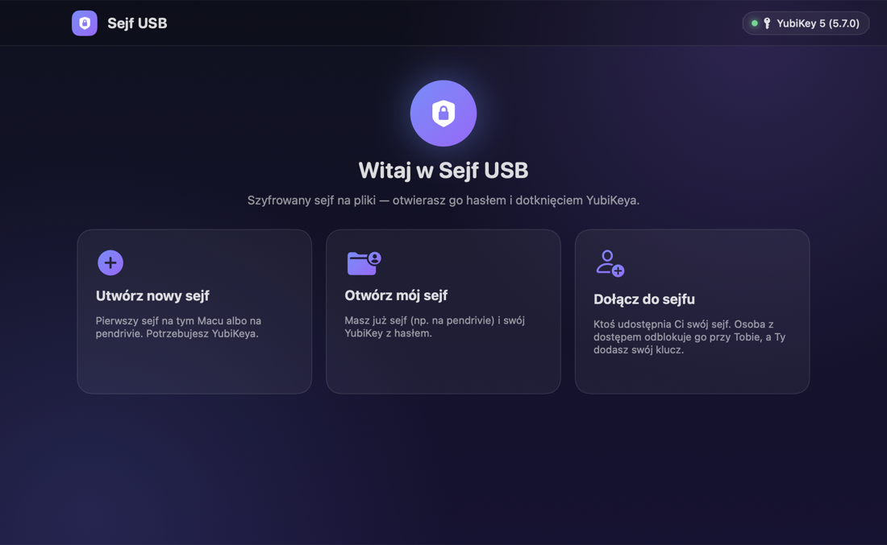
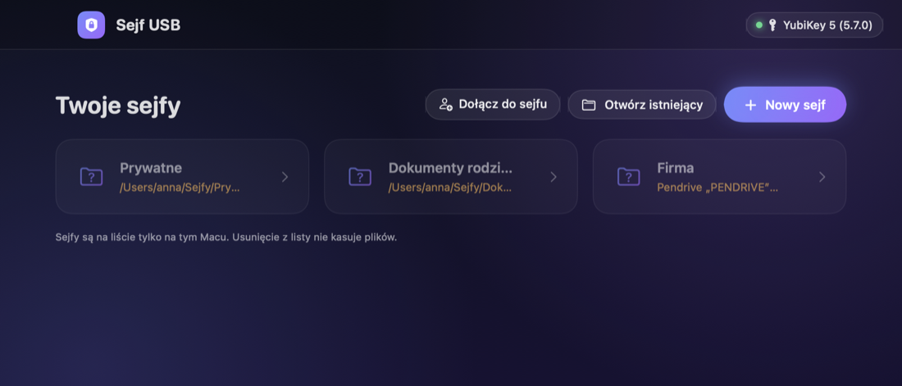
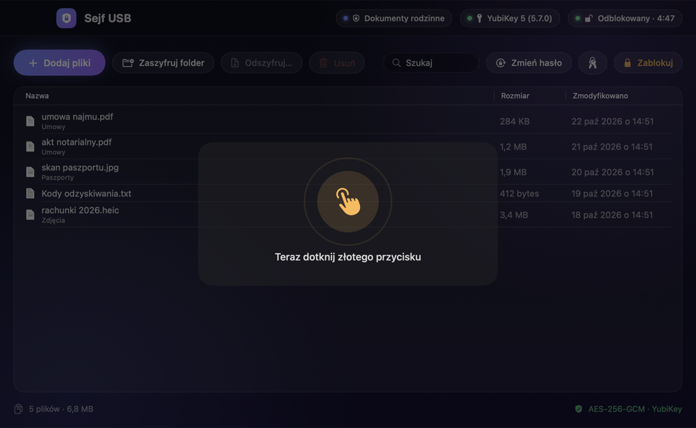

# Sejf USB

[](https://github.com/mhalaba/sejf-usb/actions/workflows/ci.yml)


[](LICENSE)

**Szyfrowany sejf na pliki dla macOS, otwierany hasłem i dotknięciem YubiKeya.** Działa w 100% offline i nie korzysta z żadnych zewnętrznych zależności ani zgód systemowych.

<p align="center"></p>

## Najważniejsze cechy

- 🔐 **AES-256-GCM.** Osobny klucz dla każdego pliku. Nazwy plików też są zaszyfrowane, a podmiana, obcięcie lub przestawienie danych zostaje wykryte.
- 🔑 **Hasło + YubiKey (FIDO2 `hmac-secret`).** Odpowiedź klucza jest częścią klucza szyfrującego, nie „bramką” w programie. Bez fizycznego klucza sejfu nie otworzy nikt, nawet znając hasło.
- 👥 **Wielu użytkowników.** Każdy otwiera wspólny sejf własnym kluczem i hasłem. Dołączanie odbywa się lokalnie, przy jednym Macu.
- 🗂 **Wiele sejfów:** na Macu albo na pendrivie.
- 🧯 **Hasło odzyskiwania** (160 bitów) na wypadek zgubienia klucza.
- ♻️ **Wymiana klucza głównego** unieważnia stare klucze, hasła i kopie nagłówka. Jest odporna na przerwanie.
- 🧹 **Bezpieczne przenoszenie plików.** Oryginał jest usuwany dopiero po kontrolnym odszyfrowaniu i porównaniu SHA-256.
- 🛡 **Ochrona środowiska:** blokada folderów iCloud, ochrona okien przed zrzutami ekranu i automatyczna blokada (bezczynność, uśpienie, odłączenie nośnika).

| Ekran powitalny | Twoje sejfy | Dotknięcie klucza |
|---|---|---|
|  |  |  |

## Instalacja

**Gotowa aplikacja:** pobierz `SejfUSB-<wersja>.zip` z zakładki [Releases](https://github.com/mhalaba/sejf-usb/releases).
1. Sprawdź sumę kontrolną:
   ```bash
   shasum -a 256 -c SejfUSB-<wersja>.zip.sha256
   ```
2. Skopiuj `Sejf USB.app` do `~/Applications`.
3. Aplikacja jest podpisana ad-hoc, bez notaryzacji Apple. Przy pierwszym uruchomieniu może być potrzebne **Ustawienia systemowe → Prywatność i ochrona → „Otwórz mimo to”**.

**Ze źródeł (zalecane):** wystarczą Command Line Tools:

```bash
git clone https://github.com/mhalaba/sejf-usb.git && cd sejf-usb
```
```bash
./build.sh test && ./build.sh
```

Aplikacja zostanie zainstalowana w `~/Applications/Sejf USB.app`.

**Wymagania:** macOS 14+ (Apple Silicon lub Intel) oraz YubiKey z FIDO2 (seria 5, Security Key, Bio).

## Dokumentacja

| | |
|---|---|
| [Instrukcja użytkownika](Docs/01-Instrukcja-uzytkownika.md) | tworzenie, odblokowanie, pliki, użytkownicy, klucze |
| [Instalacja](Docs/02-Instalacja.md) | inne Maki, Gatekeeper, odinstalowanie |
| [Bezpieczeństwo](Docs/03-Bezpieczenstwo.md) | model zagrożeń, kryptografia, audyt, ograniczenia |
| [Specyfikacja formatu](Docs/04-Specyfikacja-formatu.md) | dokładny format `Sejf.vault` |
| [Budowanie i testy](Docs/05-Budowanie-i-testy.md) | struktura kodu, testy |
| [Historia zmian](Docs/CHANGELOG.md) | |

## Jak to działa (w skrócie)

```
KEK  = HKDF-SHA256( PBKDF2-SHA256(hasło, 3 mln iteracji) ‖ FIDO2 hmac-secret(YubiKey) )
klucz główny (256 bit)  ── AES-256-GCM pod każdym KEK ──▶  keysloty w header.json
plik ── HKDF(klucz główny, ID pliku) ──▶ fragmenty 1 MiB, AES-256-GCM, numer + flaga „ostatni” w AAD
```

Tylko frameworki systemowe: CryptoKit, CommonCrypto, IOKit (FIDO2/CTAP2 przez HID), CryptoTokenKit, SwiftUI.

## Uczciwie o ograniczeniach

Żadne oprogramowanie nie daje 100% bezpieczeństwa:
- **zainfekowany Mac** widzi to samo co Ty, gdy sejf jest otwarty;
- **nadpisanie plików** na SSD lub pamięci flash nie gwarantuje zniszczenia starych bloków;
- **utrata wszystkich kluczy i hasła odzyskiwania** oznacza trwałą utratę danych.

Szczegóły: [Docs/03-Bezpieczenstwo.md](Docs/03-Bezpieczenstwo.md).

## Bezpieczeństwo i wkład

- Podatności zgłaszaj **prywatnie**: [SECURITY.md](SECURITY.md).
- Wkład w projekt: [CONTRIBUTING.md](CONTRIBUTING.md).

## English

**Sejf USB** is a native macOS file vault unlocked with **a password plus a YubiKey touch** (FIDO2 `hmac-secret`, mixed into the key derivation, not a UI gate).
- Files are encrypted with AES-256-GCM in 1 MiB authenticated chunks; file names are encrypted too.
- Supports multiple vaults (on the Mac or on a USB drive) and multiple users per vault, each with their own key and password.
- Includes a 160-bit recovery code and master-key rotation with crash-safe re-encryption.
- Fully offline, no third-party dependencies, no special macOS permissions.
- The UI and documentation are in Polish; the [format specification](Docs/04-Specyfikacja-formatu.md) is precise enough to implement independently.
- Build:
  ```bash
  ./build.sh test && ./build.sh
  ```
- MIT licensed. Report vulnerabilities privately (see [SECURITY.md](SECURITY.md)).
